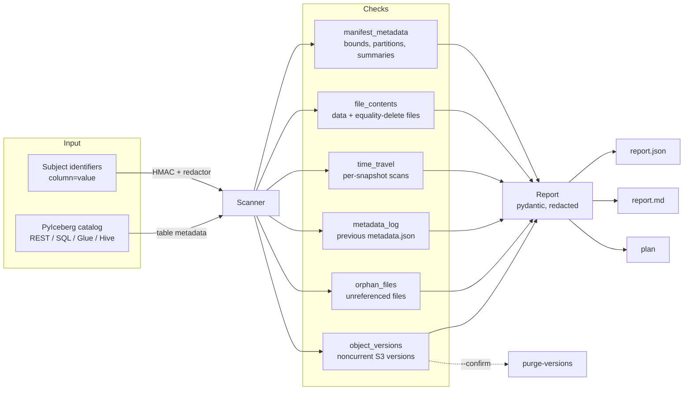

# Afterimage


**Find every place a data subject can still be recovered in an Apache Iceberg lakehouse after a `DELETE`, and produce erasure evidence once it is really gone.**

[](https://github.com/Faridkosarifard/afterimage/actions/workflows/ci.yml)


> [!IMPORTANT]
> Afterimage gathers **technical evidence**. It is **not legal advice** and a clean report does not by
> itself establish compliance with GDPR Article 17 or any other law. Decide with your data protection
> officer and counsel what "erased" has to mean for your organisation.

## Why

A right-to-erasure request ([GDPR Art. 17](https://gdpr-info.eu/art-17-gdpr/)) usually ends with
`DELETE FROM events WHERE user_id = 48213` and a closed ticket. On Iceberg that statement only changes what
the **current snapshot** returns. The bytes are still there:

| Where | Why it survives a `DELETE` |
|---|---|
| Older snapshots | Time travel (`VERSION AS OF`) reads them until they are expired. |
| Unrewritten data files | Merge-on-read writes delete files; the rows stay in the data file. |
| Equality-delete files | They store the very identifier they delete. |
| Manifest bounds | Lower/upper column bounds, including the default `truncate(16)` string prefixes. |
| Partition values and paths | `customer_id=48213/` in paths, partition tuples and manifest-list summaries. |
| Previous `metadata.json` | The metadata log keeps old snapshot lists reachable. Iceberg table encryption [does not encrypt `metadata.json`](https://iceberg.apache.org/docs/latest/encryption/). |
| Orphan files | Expiring snapshots without deleting files leaves them in storage. |
| Noncurrent object versions | With S3/MinIO versioning, deleting a file only adds a delete marker. |

The problem and the remediation sequence are described in detail in
[Deleting User Data From an Immutable Lakehouse: GDPR Hard Deletes on Iceberg](https://iceberglakehouse.com/posts/gdpr-hard-deletes-on-iceberg/).
Afterimage turns that inventory into an automated, repeatable check with a machine-readable report.

## What it does

- **Scans** one table for one subject (one or more identifiers such as a surrogate key and an email) across
  every residue class above, with no Spark cluster required.
- **Reports** findings as JSON (stable schema, pydantic models) and Markdown, with a verdict:
  `clean`, `residues_found`, or `incomplete` (a check was skipped or failed).
- **Never leaks the identifier**: values stay in memory; reports carry an HMAC-SHA256 of each identifier
  keyed by your salt, plus match counts; paths and log lines are redacted.
- **Plans** the remediation in the order that actually works: rewrite data files, rewrite manifests,
  expire snapshots, rotate metadata, remove orphans, purge noncurrent versions, re-scan.
- **Purges** noncurrent S3/MinIO object versions that reveal the subject: dry run by default, deletes only
  with `--confirm`, after a fresh scan.

## Architecture



Each check produces findings with a **kind**, a **confidence** (`confirmed` for exact matches, `possible`
for truncated bounds, truncated partitions or files that could not be parsed), the redacted location, the
snapshot ids involved and, where countable, the number of matching rows.

| Kind | Meaning |
|---|---|
| `live_rows` | The current snapshot still returns the subject: the logical delete has not happened. |
| `historical_snapshot_rows` | Rows are readable by time travel to an older snapshot (tags and branches are named). |
| `unrewritten_data_file` | A current data file still holds the rows, masked only by delete files. |
| `historical_data_file` | A file referenced only by older snapshots still exists and holds the rows. |
| `equality_delete_file` | An equality-delete file stores the identifier. |
| `column_bound` | A manifest lower/upper bound equals the identifier or its truncated prefix. |
| `partition_value` | A partition tuple / Hive-style path is derived from the identifier. |
| `partition_summary` | A manifest-list partition summary bound is derived from the identifier. |
| `metadata_log_snapshot` | A previous `metadata.json` still lists expired snapshots whose files reveal the subject. |
| `orphan_data_file` | An unreferenced data file in storage holds the rows. |
| `orphan_metadata_file` | An unreferenced manifest, manifest list or metadata file may describe the subject. |
| `noncurrent_object_version` | A deleted or overwritten object version is still retrievable. |

## Quickstart

```bash
pip install "afterimage @ git+https://github.com/Faridkosarifard/afterimage"

# A salt keeps hashes in the report unlinkable for anyone who does not know it.
# Store it in your secret manager; reuse it to re-derive hashes during an audit.
export AFTERIMAGE_SALT="$(openssl rand -hex 32)"

# Keep raw identifiers out of shell history: put them in a file (or pipe them via stdin).
cat > subject.txt <<'TXT'
customer_id=48213
email=erika.mustermann@example.de
TXT

afterimage scan \
  --catalog lake -p type=rest -p uri=https://catalog.example.com \
  --table crm.customers \
  --match-file subject.txt \
  --json-out evidence.json --markdown-out evidence.md
echo "exit code: $?"   # 0 clean, 3 residues found, 4 incomplete

afterimage plan --report evidence.json --catalog lake
afterimage purge-versions --catalog lake --table crm.customers --match-file subject.txt            # dry run
afterimage purge-versions --catalog lake --table crm.customers --match-file subject.txt --confirm  # deletes
```

Catalog configuration follows PyIceberg: `~/.pyiceberg.yaml`, `PYICEBERG_CATALOG__<NAME>__<PROP>`
environment variables, or `-p key=value` on the command line. `s3.*` properties are reused for the
object-version check.

### As a library

```python
import os

from pyiceberg.catalog import load_catalog
from afterimage import Identifier, ScanOptions, Subject, scan_table
from afterimage.render import to_json

table = load_catalog("lake").load_table("crm.customers")
subject = Subject(
    [Identifier("customer_id", "48213"), Identifier("email", "erika.mustermann@example.de")],
    salt=os.environ["AFTERIMAGE_SALT"],
)
report = scan_table(table, subject, ScanOptions(object_versions=True))
print(report.verdict, report.summary)
open("evidence.json", "w").write(to_json(report))
```

## Demo

```bash
make install
make demo-up     # MinIO with a versioned bucket + Iceberg REST catalog (docker compose)
make demo        # create table, DELETE, scan, maintain, scan, purge versions, final clean scan
make demo-down

make demo-local  # same walkthrough without Docker: moto S3 server + sqlite catalog
```

The walkthrough writes `demo/out/01-after-delete.{json,md}`, `02-after-maintenance.*` and `03-final.*`.
After the `DELETE`, the scan finds time-travel rows, the old data file, bounds, partition values and
summaries. After Iceberg maintenance only noncurrent object versions remain. After the purge the verdict is
`clean`.

## Example report (excerpt)

```json
{
  "schema_version": "1.0",
  "tool": "afterimage",
  "tool_version": "0.1.0",
  "table": {
    "identifier": "crm.customers",
    "location": "s3://warehouse/demo/crm/customers",
    "format_version": 2,
    "current_snapshot_id": 8900457153689750215,
    "snapshot_count": 2
  },
  "subject": {
    "hash_algorithm": "hmac-sha256",
    "salt_fingerprint": "aac84929d5d041a3",
    "salt_was_generated": false,
    "identifiers": [
      {"column": "customer_id", "field_id": 1, "iceberg_type": "long",
       "salted_hash": "3760c6787741c063faea7903affa4c66d72760a22e291559ca09ea549c0565fa",
       "findings": 6, "confirmed_matches": 2},
      {"column": "email", "field_id": 2, "iceberg_type": "string",
       "salted_hash": "3c3811a32e638b41dd7c8315639c22cf1b4c9d892a5866fa3c2458769d5c5e23",
       "findings": 3, "confirmed_matches": 2}
    ]
  },
  "verdict": "residues_found",
  "findings": [
    {
      "kind": "historical_snapshot_rows",
      "confidence": "confirmed",
      "location": "crm.customers@7112932236831820633",
      "column": "customer_id",
      "snapshot_ids": [7112932236831820633],
      "match_count": 1,
      "detail": "rows are readable with time travel (VERSION AS OF 7112932236831820633)"
    },
    {
      "kind": "column_bound",
      "confidence": "possible",
      "location": "s3://warehouse/demo/crm/customers/data/customer_id=[redacted:3760c6787741]/00000-0-a1010d0c.parquet",
      "column": "email",
      "snapshot_ids": [7112932236831820633, 8900457153689750215],
      "detail": "lower bound is the identifier truncated to 16 characters and upper bound is the identifier truncated to 16 characters with the last character incremented in the manifest entry of a data file"
    }
  ],
  "summary": {
    "column_bound": 2, "historical_data_file": 2, "historical_snapshot_rows": 2,
    "noncurrent_object_version": 1, "partition_summary": 2, "partition_value": 1
  },
  "disclaimer": "This report is technical evidence gathered by an automated scan. It is not legal advice and does not by itself establish compliance with GDPR Article 17 or any other law."
}
```

The full schema is documented in [docs/report-format.rst](docs/report-format.rst).

## Limitations

- **Iceberg only, one table at a time.** Replicas, downstream copies, caches, BI extracts, backups and
  logs are out of scope; so are other tables that join on the same key.
- **Identifier types:** `string`, `int`, `long` and `uuid` columns (top-level or nested in structs).
  Hashed, tokenised or free-text occurrences (for example an email inside a JSON blob) are not found.
- **Equality deletes:** PyIceberg cannot apply them yet, so time travel on snapshots that contain them falls
  back to counting rows physically present and reports them as `possible`.
- **Format v3 deletion vectors and encrypted tables** are not evaluated specially. Encrypted manifests and
  data files cannot be parsed, so they come up as `possible` findings that need review.
- **`bucket[N]` and time partitions** are not reported, because many subjects share a bucket.
- **Noncurrent `metadata.json` versions** are flagged as `possible` without being parsed.
- **Cost:** every snapshot is scanned and candidate files are read. Bounds-based pruning skips files that
  cannot contain the subject, but very long histories still take time. Disable individual checks with
  `--no-time-travel`, `--no-orphans` and so on; the verdict then becomes `incomplete`.
- **Point in time:** a concurrent writer or a restore from backup can reintroduce data after the scan.
- Afterimage **does not compact, expire or remove orphans** itself. It tells you which engine procedure
  to run, because those operations need the table's own concurrency and safety settings.

## Roadmap

- Delta Lake and Apache Hudi support (transaction logs, checkpoints, deletion vectors, timeline).
- **Boundleak**, a companion tool that audits manifests and partition specs for personal data *before*
  an erasure request arrives, so metrics and partitioning can be fixed up front.
- Native evaluation of equality deletes and format v3 deletion vectors.
- GCS and Azure Data Lake object versions (soft delete, generations).
- Signed reports (Sigstore or detached signatures) for tamper-evident audit trails.
- A batch mode that checks many subjects in one pass over the metadata.

## Development

```bash
make install   # virtualenv + editable install with dev dependencies
make check     # ruff, mypy --strict, pytest
make cov       # coverage report
```

See [CONTRIBUTING.rst](CONTRIBUTING.rst) for the workflow and [CHANGELOG.rst](CHANGELOG.rst) for releases.

## License

Apache License 2.0. See [LICENSE](LICENSE).
